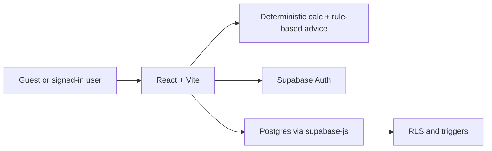
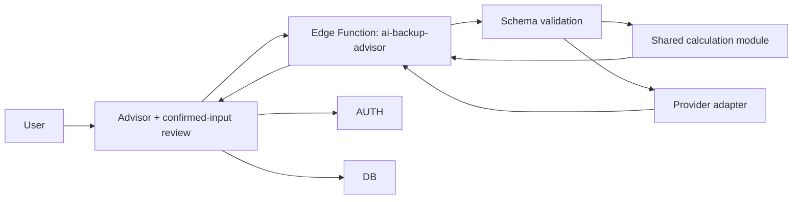

# PowerUp — Project Documentation

**Product:** PowerUp Home Backup Planner  
**Stack:** React 18, TypeScript, Vite, Tailwind CSS, Supabase  
**Last updated:** 2026-10-12

This document consolidates product requirements, technical architecture, design direction, Supabase setup, AI advisor contract, implementation roadmap, and contributor guidance in one place.

**Layout:** `frontend/` is the Vite + React app. `backend/supabase/` holds migrations, Edge Functions, and SQL tests.

---

## Table of contents

1. [Overview and quick start](#1-overview-and-quick-start)
2. [Product requirements](#2-product-requirements)
3. [Technical architecture](#3-technical-architecture)
4. [Design and UX](#4-design-and-ux)
5. [Supabase setup and operations](#5-supabase-setup-and-operations)
6. [AI Backup Advisor contract](#6-ai-backup-advisor-contract)
7. [Implementation roadmap](#7-implementation-roadmap)
8. [Contributing and validation](#8-contributing-and-validation)

---

## 1. Overview and quick start

PowerUp helps households plan backup power during load-shedding. Enter your backup system and appliance list to calculate battery runtime, load, inverter and surge checks, and practical operating recommendations. Results can compare larger battery-bank scenarios when the current system falls short.

### Features

- Backup setup for inverter, solar, generator, or no installed system
- Appliance presets and custom entries
- Battery capacity, runtime, inverter-load, and surge calculations
- Rule-based outage recommendations and outage timeline
- Battery capacity upgrade comparisons
- Optional accounts, private saved plans, and moderated community feedback (Supabase)
- Private monitoring for saved plans with optional manual readings and historical trends
- AI Backup Advisor (primary product direction): guided intake, confirmation boundaries, grounded explanations

### Run locally

```sh
cd frontend
npm install
npm run dev
```

From the repository root, the same npm scripts work after frontend dependencies are installed. Supabase is optional for guest calculations. For accounts, saved plans, manual readings, and feedback, set `VITE_SUPABASE_URL` and `VITE_SUPABASE_ANON_KEY` in `frontend/.env.local` (see [§5](#5-supabase-setup-and-operations)). Monitoring uses the saved plan as the system record; it does not connect to equipment or show live telemetry.

### Validation

```sh
npm run test:backup-upgrades
npm run test:monitoring-data
npm run test:ai-advisor
npm run build
```

Upgrade tests exercise the calculation engine and battery comparisons. Advisor tests use a mocked provider (validation, confirmation boundaries, grounded explanations, failure handling). Database contract tests need a local Supabase stack and Docker ([§5](#5-supabase-setup-and-operations)).

The AI Advisor is available from Home and navigation. It gathers conversation details as suggestions, requires explicit confirmation, and hands off to the calculator wizard. The results page calculates locally and can request an AI explanation grounded in those results. Hosted AI requires the Edge Function, quota migration, and server-only secrets ([§5–6](#5-supabase-setup-and-operations)). The manual calculator remains the fallback.

---

## 2. Product requirements

**Status:** Product target and implementation gap

### 2.1 Summary

The **AI Backup Advisor is the primary experience**: it guides users through home, outage, equipment, and essential loads; asks for missing information; and explains a tailored plan in plain language. A **deterministic calculation engine** supplies all load, energy, capacity, and runtime figures. AI organizes and explains; it must not invent specifications or replace the engine.

Guests can plan without signing in. Sign-in enables private plan storage, plan management, and manually entered monitoring readings. Monitoring reflects saved configuration and recorded observations, not live hardware.

### 2.2 Principles

1. **AI guides the journey** — visible from home through planning and explanation.
2. **Numbers are calculated, not generated** — AI explains deterministic outputs only.
3. **Unknown stays unknown** — ask or explain limits; never silently invent values.
4. **Users control data** — guest sessions are not saved; authenticated users save explicitly.
5. **No false telemetry** — manual readings are labeled with source and timestamp.
6. **Safe and understandable** — show assumptions; no unsafe wiring or repair instructions.

### 2.3 Users

Household planners, technically informed owners, guests, returning account holders, and PowerUp moderators (feedback).

### 2.4 Scope (in)

AI-guided intake; review/edit before calculation; deterministic calculations and rule-based advice; guest and account flows; My Plans CRUD; monitoring with manual readings; feedback and moderation; responsive, accessible UI ([§4](#4-design-and-ux)).

### 2.5 Scope (out)

Live inverter/BMS/MQTT integrations; forecasts and automated fault diagnosis; AI installation instructions; AI-initiated save/delete/purchase; public exposure of private plans or raw AI conversations.

### 2.6 Key functional requirements (abbreviated)

| Area | Requirement |
|------|-------------|
| Advisor | Collect/confirm backup type, outage, appliances, battery, inverter, solar; follow-ups for gaps; review before calculate; grounded explanations with fallback |
| Calculations | Engine-only load/energy/runtime; label estimates; 85% inverter efficiency, chemistry DoD, 20% planning margin documented |
| Guest/account | Guests calculate without DB writes; Auth via Supabase; explicit save after sign-in |
| Plans | Stable ID, owner, snapshots; idempotent save; owner-only RLS |
| Monitoring | Plan selector; manual readings with validation; trends from stored data only |
| Feedback | 5–2000 chars, rate limit, moderation |

### 2.7 Non-functional

RLS and least-privilege; AI schema validation and timeouts; accessibility and responsive layouts; deterministic planning when AI is down.

### 2.8 Acceptance criteria

Guest advisor → review → calculate; no fabricated runtime without capacity; AI matches calculator; fallback wizard; plan CRUD without duplicates; cross-account isolation; monitoring without fake telemetry; feedback moderation.

### 2.9 Implementation gap

The repo includes wizard, calculator, saved plans, monitoring, Auth, and feedback. Conversational AI UI and Edge Function exist locally; **hosted AI rollout and some acceptance steps remain pending** ([§7](#7-implementation-roadmap)). PRD AI-first items are direction, not a claim that every hosted path is live.

### 2.10 Open decisions

Model provider budget/retention (Groq chosen for v1 — [§6](#6-ai-backup-advisor-contract)); guest AI limits; transcript retention (default none); wizard vs full advisor replacement; localization.

---

## 3. Technical architecture

**Status:** Current implementation plus target AI architecture

### 3.1 Current system



Calculation and advice run in the frontend. Browser uses `@supabase/supabase-js` directly (no custom API server).

### 3.2 Target AI system



Model credentials live only in the Edge Function. Saving stays explicit browser → Supabase with RLS.

### 3.3 Code map

| Area | Location |
|------|----------|
| App shell / navigation | `frontend/src/App.tsx` |
| Setup wizard | `frontend/src/components/setup/backup-wizard.tsx` |
| Calculations | `frontend/src/lib/calculations.ts` |
| Advice / upgrades | `frontend/src/lib/backup-advice.ts`, `frontend/src/lib/backup-upgrade-advisor.ts` |
| Auth | `frontend/src/context/auth-context.tsx`, `frontend/src/lib/supabase.ts` |
| Plans | `frontend/src/components/plans/plan-library-page.tsx` |
| Monitoring | `frontend/src/components/dashboard/unit-monitoring-dashboard.tsx`, `frontend/src/lib/monitoring-data.ts` |
| Feedback | `frontend/src/components/feedback/*` |
| AI client / contract | `frontend/src/lib/advisor-client.ts`, `frontend/src/lib/ai-advisor-contract.ts` |
| Edge Function | `backend/supabase/functions/ai-backup-advisor/` |
| Schema | `backend/supabase/migrations/*`, `backend/supabase/tests/security_contract.test.sql` |
| Validation scripts | `frontend/scripts/*.mjs` |

### 3.4 Data model (summary)

- **`profiles`** — linked to `auth.users`; display name, avatar.
- **`backup_plans`** — stable client `id`, `user_id`, `plan_name`, `backup_configuration` (canonical `SetupInputs`), `selected_appliances` (snapshot; nested config is canonical), `calculation_results` snapshot.
- **`system_readings`** — manual observations tied to plan + owner; composite FK; range constraints.
- **`feedback`** — pending → approved public feed; rate limits.
- **`admin_users`** — allowlist; no direct browser access.

### 3.5 Security

- Client: `VITE_SUPABASE_URL`, `VITE_SUPABASE_ANON_KEY` only.
- RLS on all user data; feedback rate limit via scoped `SECURITY DEFINER` trigger.
- AI output is untrusted until schema-validated.
- Audit default table ACLs separately from RLS.

### 3.6 Calculation contract

`calculateBackupPlan()` derives connected load, estimated/planned energy, usable capacity (chemistry DoD × 0.85 efficiency), suggested battery/inverter sizing, runtime when inputs allow. **Single source of truth:** shared module + `CALCULATION_ENGINE_VERSION` for browser and Edge Function parity.

### 3.7 Migrations (order)

1. `20261011000000_powerup_accounts_plans_feedback.sql`
2. `20261011010000_feedback_admin_moderation.sql`
3. `20261011020000_ai_backup_chat_quota.sql` (historical)
4. `20261011030000_ai_guest_chat_quota.sql` (historical)
5. `20261012000000_remove_ai_backup_advisor.sql` (drops obsolete quota objects)
6. `20261012010000_add_manual_system_readings.sql`
7. `20261012020000_grant_backup_plan_id_insert.sql`
8. `20261012030000_fix_feedback_rate_limit_permissions.sql`
9. `20261012040000_add_ai_advisor_request_quota.sql` — **local; hosted apply blocked pending schema inspection** ([§5](#5-supabase-setup-and-operations))

### 3.8 Known limitations

- Reopen recalculates from inputs (not frozen snapshot).
- Duplicate appliance fields in plan row (nested config is canonical).
- No live equipment integration.
- AI hosted deployment and full E2E verification pending.

---

## 4. Design and UX

**Theme:** Trustworthy, practical, modern energy-tech — not generic dashboard clutter.

### 4.1 References

- Layout inspiration: `frontend/design-references/dashboard.jpeg`
- Palette: `frontend/design-references/color-pallete.jpeg`

### 4.2 User journey

Home → Backup setup (or AI Advisor) → Calculated backup plan → optional save / monitoring.

### 4.3 Color tokens

| Token | Light | Dark |
|-------|-------|------|
| Background | `#FBFBFD` | `#0E0E12` |
| Surface | `#FFFFFF` | `#16161D` |
| Primary (Solar Amber) | `#E5A93C` (hover `#C99E3B`) | — |
| Accent | `#D97706` / `#F59E0B` | glow `#FDE692` |
| Text | `#111116` / muted `#5A5A68` | `#F4F4F6` / `#9A9AA6` |
| Border | `#E8E8EE` | `#272732` |
| Success / Warning / Error | `#10B981` / `#F59E0B` / `#EF4444` | — |

### 4.4 Implementation in code

- Navigation: `frontend/src/components/navbar/notch-navbar.tsx`
- Primary CTA button: `frontend/src/components/ui/interactive-hover-button.tsx`
- Theme: `frontend/src/context/theme-context.tsx`, Tailwind dark mode

### 4.5 UX rules

- Clear hierarchy, consistent spacing, readable type, accessible contrast and focus.
- Subtle motion only; respect `prefers-reduced-motion`.
- No Three.js/WebGL; no fabricated runtime or specs.
- Responsive mobile through desktop; touch-friendly controls.
- Every control must work (validate forms, real calculations, honest empty/error states).

---

## 5. Supabase setup and operations

### 5.1 Project configuration

1. Create a Supabase project.
2. Copy URL and publishable (or legacy anon) key from **Project Settings → API**.
3. `frontend/.env.local`:

   ```env
   VITE_SUPABASE_URL=https://your-project-ref.supabase.co
   VITE_SUPABASE_ANON_KEY=your-publishable-or-anon-key
   ```

4. From `backend/`, link the CLI and apply migrations in order with `supabase db push` (compare hosted migration ledger first).
5. **Authentication → URL Configuration:** local and deployed origins; password reset via `/?screen=reset`.
6. Configure email verification as needed.

Never put service-role or provider keys in `VITE_*` variables.

### 5.2 AI Advisor deployment (checklist)

Local tests: `npm run test:ai-advisor`, `test:backup-upgrades`, `test:monitoring-data`, `npm run build`.

Local DB contract (Docker), from `backend/`: `supabase start`, `supabase db reset`, `supabase test db` — **local only, never on linked production.**

Edge Function secrets (server-side): `GROQ_API_KEY`, `AI_RATE_LIMIT_SECRET` (≥32 chars), optional `GROQ_MODEL`. Local: `backend/supabase/functions/.env` (gitignored). Optional `npm run verify:groq` for one live provider smoke test.

Before hosted push: verify project ref, migration history, `db push --dry-run`. Migration `20261012040000` creates quota metadata only (no prompts stored). **As of 2026-10-12:** push to project `nywhnxptqycunbpyusst` stopped because `ai_advisor_request_usage` already exists — inspect remote schema before retry.

Guest AI requires `AI_TRUSTED_IP_HEADER` set to a gateway-overwritten client IP header; otherwise guest AI fails closed.

Deploy function `ai-backup-advisor` after approval. `verify_jwt = false` allows guest reach; function validates keys, auth, and quota internally.

### 5.3 Administrator setup

After verified signup, insert UUID into `admin_users` via SQL Editor (project owner only). Moderator uses **Recheck access** after re-login.

### 5.4 Monitoring and AI explanation

Explanation sends **only** the selected saved plan specs — not manual readings or notes. Switching plans clears in-flight explanations.

---

## 6. AI Backup Advisor contract

**Version:** 1 · **Provider:** Groq, `openai/gpt-oss-20b` (adapter-swappable)

### 6.1 Policy

- Guests: browser-only draft; no Supabase conversation storage.
- Signed-in: AI never auto-saves; explicit save to `backup_plans`.
- English and Urdu supported in v1.
- Send bounded turns + confirmed fields + server calculation results for explanations only — no emails, plan IDs, or monitoring readings in planning requests.
- No transcript persistence; quota metadata only.
- Quotas (initial): guest 5/hr, 20/day; user 20/hr, 60/day; project 20/min, 800/day. Intake and explanation both count.

### 6.2 HTTP contract

`POST /functions/v1/ai-backup-advisor`, `version: 1`. Types: `frontend/src/lib/ai-advisor-contract.ts`. Proposals require user confirmation before entering `SetupInputs`. Model cannot return authoritative calculations or DB operations. Explanation output checked against server results; `explanationSource`: `ai` | `rules`.

Limits: 20 KiB body, 8 turns, 15s provider timeout. Stable error codes for validation, auth, quota, invalid output, missing config.

### 6.3 Numerical authority

Edge Function computes `calculatedResults`; browser verifies version, inputs, and results before showing AI prose. Shared `calculateBackupPlan()` and appliance catalog.

---

## 7. Implementation roadmap

Gated sequence for AI-first product. **One step per approval**; no hosted migrations/deploy without explicit approval.

| Step | Goal | Status |
|------|------|--------|
| 1 | AI contract and provider | Done ([§6](#6-ai-backup-advisor-contract)) |
| 2 | Secure Edge Function + tests | Done locally; hosted pending |
| 3 | AI-guided primary UI | Local UI; live service pending deployment |
| 4 | Calculations + saved plans | Local explanation UI; hosted E2E pending |
| 5 | Monitoring + AI (no telemetry claims) | Local; live pending |
| 6 | Evaluations and release checks | Local tests/build; Docker SQL + user sign-off pending |
| 7 | Hosted rollout | Quota migration conflict — inspect remote before writes |

**Agent rules:** Read this doc and source before changes; respect uncommitted user work; never paste secrets in chat; preserve calculator, guest mode, RLS, and manual monitoring.

---

## 8. Contributing and validation

### 8.1 Commands

| Command | Purpose |
|---------|---------|
| `npm install` (in `frontend/`) | Dependencies |
| `npm run dev` | Dev server |
| `npm run build` | Production build |
| `npm run test:backup-upgrades` | Calculation engine |
| `npm run test:monitoring-data` | Monitoring logic |
| `npm run test:ai-advisor` | Advisor contract (mocked provider) |
| `npm run verify:groq` | Optional live Groq intake |

No dedicated lint script; use build + focused tests.

Single test file: `node --test frontend/scripts/test-backup-upgrades.mjs` (optional `--test-name-pattern`).

### 8.2 Conventions

- Domain logic in `frontend/src/lib/*.ts`; UI in `frontend/src/components/*`.
- Typed `SetupInputs` / `CalculationResults` across screens.
- Guest vs account-backed features: env + migrations required for latter.
- AI flow: review-driven confirmation before save or explanation.
- Imports: `@/*` alias.

### 8.3 Where to start by task

| Task | Start here |
|------|------------|
| Screen flow | `frontend/src/App.tsx` |
| Calculations | `frontend/src/lib/calculations.ts` |
| Supabase / schema | [§5](#5-supabase-setup-and-operations), `backend/supabase/migrations/` |
| AI behavior | [§6](#6-ai-backup-advisor-contract), `frontend/src/lib/ai-advisor-contract.ts` |

---

*For a one-line product pitch and clone-friendly intro, see [README.md](README.md).*
