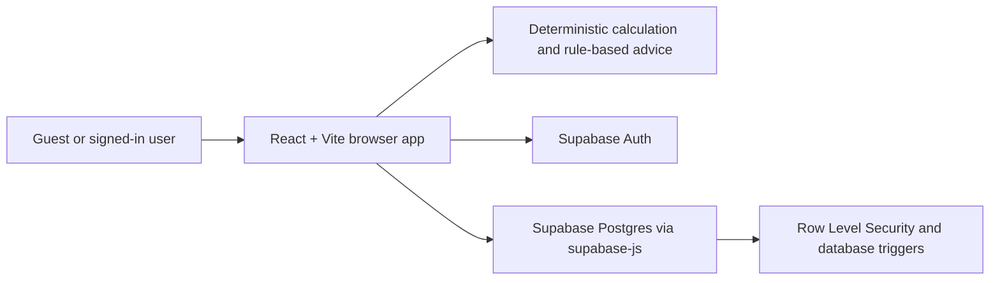
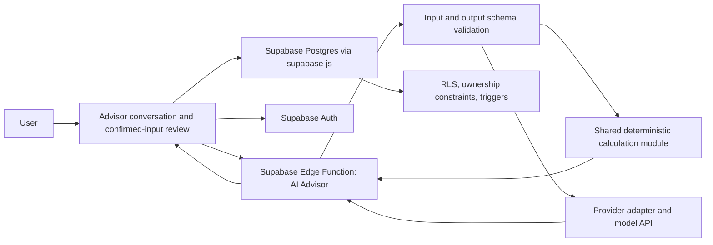

# PowerUp Technical Requirements Document

**Status:** Current architecture plus target AI architecture  
**Last updated:** 2026-10-12

## 1. Purpose and implementation status

This document describes the existing PowerUp implementation and the technical changes required to make the AI Backup Advisor central to the product. The current app is a React/Vite client with direct Supabase access for Auth and user data. The Advisor intake UI and Edge Function source now exist locally. The hosted Edge Function and new quota migration are not verified as deployed, so live AI intake remains pending rollout.

## 2. Architecture

### Current system



The browser uses `@supabase/supabase-js` directly. There is no custom API server or current Edge Function in the repository. Calculation and rule-based recommendation logic run in the frontend.

### Target AI-first system



The Edge Function must be the only place that holds model credentials. The model returns explanation and structured recommendations; validated deterministic calculations remain authoritative. Saving remains an explicit browser-to-Supabase action protected by RLS. AI conversation content should not be persisted unless a separately approved product requirement defines retention and consent.

## 3. Technology stack and code responsibilities

| Area | Current implementation | Responsibility |
|---|---|---|
| UI | React 18, TypeScript, Vite, Tailwind CSS | Home, setup wizard, results, Auth, plan library, Monitoring, feedback |
| Auth/data SDK | `@supabase/supabase-js` | Browser Auth, PostgREST reads/writes, RPC calls |
| Auth state | `src/context/auth-context.tsx` | Session, profile display name, admin status, sign out |
| Client configuration | `src/lib/supabase.ts` | Validates URL and creates browser-safe Supabase client |
| App flow | `src/App.tsx` | Screen navigation, guest draft, calculation, plan save/update/open |
| Wizard | `src/components/setup/backup-wizard.tsx` | User input and appliance selection |
| Calculation | `src/lib/calculations.ts` | Deterministic load, energy, capacity, runtime and sizing values |
| Advice | `src/lib/backup-advice.ts`, `src/lib/backup-upgrade-advisor.ts` | Rule-based explanations and comparison scenarios |
| Plans | `src/components/plans/plan-library-page.tsx` | List, open, rename, delete saved plans |
| Monitoring | `src/components/dashboard/unit-monitoring-dashboard.tsx`, `src/lib/monitoring-data.ts` | Saved system selection, manual readings, trends and validation |
| Feedback | `src/components/feedback/*` | Submission, own submissions, public feed, moderation |
| DB schema/security | `supabase/migrations/*`, `supabase/tests/security_contract.test.sql` | Tables, indexes, functions, triggers, policies, grants and contract checks |

## 4. Current data model

### `public.profiles`

- `id uuid`: primary key and foreign key to `auth.users(id)`; auth-user deletion cascades.
- `display_name text`, `avatar_url text nullable`, `created_at`, `updated_at`.
- A trigger creates a profile for a new Auth user. Users can read and update their own profile fields.

### `public.backup_plans`

- `id uuid`: stable primary key; app generates it client-side for retry safety.
- `user_id uuid`: owner and foreign key to `auth.users(id)`.
- `plan_name text` (1–80 characters).
- `backup_configuration jsonb`: canonical saved `SetupInputs`, including appliance details.
- `selected_appliances jsonb`: compatibility/snapshot field that duplicates the appliance selection embedded in `backup_configuration`; current calculations and Monitoring use the nested configuration.
- `calculation_results jsonb`: stored calculation and rule-based advice snapshot.
- `created_at`, `updated_at`; update trigger refreshes `updated_at`.
- Index: `(user_id, updated_at desc)`.

### `public.system_readings`

- `id uuid`, `system_id uuid`, `user_id uuid`, `recorded_at timestamptz`.
- Nullable observed values: `battery_percentage`, `battery_voltage`, `load_watts`, `solar_generation_watts`, `notes`.
- Composite foreign key `(system_id, user_id)` references `(backup_plans.id, backup_plans.user_id)` and cascades when the plan is deleted.
- Constraints bound numeric values, require at least one measurement, and a trigger checks battery/solar fields against the associated saved configuration.
- Index: `(user_id, system_id, recorded_at desc)`.

### `public.feedback`

- `id uuid`, `user_id uuid`, optional `rating`, required `comment`, `feedback_type`, `status`, timestamps.
- Status starts as `pending`; approved feedback is visible publicly.
- Feedback ownership/status trigger and five-per-hour rate-limit trigger.
- `get_my_feedback()` returns the caller's recent submissions without exposing user IDs through the public feed.

### `public.admin_users`

- `user_id uuid` primary key referencing `auth.users(id)` and `created_at`.
- RLS enabled; browser roles receive no direct access. Administrator actions use `is_feedback_admin()` and RLS policies.

## 5. Security and authorization

- Supabase Auth provides the identity; the browser client uses only `VITE_SUPABASE_URL` and `VITE_SUPABASE_ANON_KEY` (a publishable/legacy anon key).
- Never use a service-role or model-provider secret in a `VITE_*` variable or frontend bundle.
- RLS is enabled on profiles, plans, feedback, admin users, and readings.
- Plans: authenticated owner may select, insert, update, and delete rows where `auth.uid() = user_id`.
- Profiles: owner-only select/update.
- Readings: owner-only CRUD, additionally constrained by the composite plan-owner foreign key.
- Feedback: public select is limited to approved rows; authenticated users may submit pending feedback and access their own rows; admin moderation is separately authorized.
- Feedback rate limiting runs in a narrowly scoped `SECURITY DEFINER` trigger function with an empty `search_path`. The authenticated caller is checked against `NEW.user_id`; direct function execution is revoked. This avoids granting clients access to private `feedback.user_id` values.
- Model endpoint requests must validate caller identity for account features, validate request sizes/types, enforce guest abuse limits, and avoid logging raw personal data. AI output is untrusted input and must be schema-validated before display.

**Deployment note:** A prior metadata inspection found broad default table ACLs for `anon` on some tables. RLS denies access to private rows where no anonymous policy exists, but least-privilege ACLs should be audited and explicitly narrowed in a separate reviewed migration. Do not assume RLS removes table grants.

## 6. Calculation contract

`SetupInputs` includes backup type, battery presence/chemistry, voltage, amp-hours or direct kWh, inverter continuous/surge ratings, optional solar panel details, target outage, appliance quantities/watts/surge/hours/priorities, and priority mode.

`calculateBackupPlan()` currently computes:

- **Connected load (W):** sum of each entered/preset appliance watts multiplied by quantity.
- **Estimated energy (Wh):** sum of watts × quantity × operating hours.
- **Planned energy (Wh):** same energy calculation after applying the selected priority mode.
- **Nominal capacity (Wh):** direct kWh × 1,000, or system voltage × total Ah, only when capacity is known.
- **Usable capacity (Wh):** nominal capacity × chemistry discharge limit × 0.85 inverter-efficiency assumption. Current discharge limits: LiFePO₄ 0.90, lead-acid 0.50, AGM 0.65; unknown chemistry yields no runtime estimate.
- **Suggested nominal battery capacity:** planned energy × 1.20 planning margin divided by discharge limit and 0.85 efficiency.
- **Suggested inverter rating:** connected load with a 25% margin, rounded up to the next 100 W.
- **Runtime estimate:** usable capacity divided by continuous or priority-adjusted average load; only when the required inputs are present.

These are planning estimates. The model must never produce alternate numerical answers. Target AI implementation should move the deterministic engine and appliance catalog into an environment-neutral shared module or otherwise guarantee that frontend and Edge Function use the same versioned logic.

## 7. Main workflows

### AI-guided plan (target)

1. User starts from the Advisor.
2. The UI sends conversation turns to the Edge Function; the function validates input and asks the provider for the next question or structured candidate fields.
3. UI shows extracted values as unconfirmed until the user accepts or edits them.
4. Once complete, shared deterministic code calculates metrics. The AI receives only confirmed inputs plus calculation outputs and returns a grounded explanation and recommendations.
5. UI validates and displays the structured response, assumptions, unknowns, and fallback behavior.
6. Guest session remains in client memory/session draft; authenticated user can explicitly save the plan through Supabase.

### Save/open/update plan (current)

1. App builds a row from authenticated `user.id`, plan name, JSON configuration, appliance snapshot, and calculation/advice snapshot.
2. New plans use a stable generated UUID. Duplicate retry checks whether that UUID is already owned by the caller, then updates that row.
3. Open, rename, update, and delete use the stable plan ID; owner-based RLS is the database boundary.
4. Current reopen flow restores the saved configuration and recalculates results; it does not render the stored calculation snapshot verbatim. Formula/catalog changes can therefore alter displayed results for an older plan.

### Monitoring (current)

1. Authenticated client selects `backup_plans`; RLS scopes records to the user.
2. Selector preserves the selected plan ID when possible, otherwise selects the most recently updated plan.
3. Configuration overview and calculated load are based on the selected saved plan.
4. Readings query filters by selected `system_id`, while RLS and foreign key also enforce ownership.
5. Manual reading inserts have stable IDs and validated user-entered values; graphs use persisted observations only.

### AI endpoint (target)

- Suggested function name: `ai-backup-advisor`.
- Provider/model is a configuration decision; keep provider-specific calls behind a small adapter.
- Request should include a bounded conversation context, confirmed structured input, and an explicit action/schema version.
- Response should be typed, for example `assistantMessage`, `nextQuestion`, `candidateInputUpdates`, `recommendations`, `safetyNotes`, and a request/response version. Do not send model-generated DB operations or accept model-generated calculation fields.
- Keep temperature/tokens/request size appropriate for predictable extraction and concise explanations. Validate provider JSON/structured output and handle timeouts, quota errors, and invalid output.
- AI chat persistence is off by default. If transcript persistence is later approved, define retention, deletion, consent, and RLS before implementation.

## 8. Environment and configuration

Required client settings:

```env
VITE_SUPABASE_URL=https://<project-ref>.supabase.co
VITE_SUPABASE_ANON_KEY=<publishable-or-legacy-anon-key>
```

AI target settings belong only in Supabase Edge Function secrets or another server-side secret store, for example a provider API key and model identifier. Exact names depend on provider selection. Never add these secrets to `.env.local` variables prefixed `VITE_`.

Configure Auth site/redirect URLs for local and deployed app origins, email verification, and password recovery. Current frontend routes reset through `/?screen=reset`.

## 9. Migrations and deployment

The repository migration sequence is:

1. `20261011000000_powerup_accounts_plans_feedback.sql` — account profile, plans, feedback, triggers, baseline RLS.
2. `20261011010000_feedback_admin_moderation.sql` — admin allowlist, moderation, column grants and feedback safeguards.
3. `20261011020000_ai_backup_chat_quota.sql` — historical authenticated AI quota objects.
4. `20261011030000_ai_guest_chat_quota.sql` — historical guest AI quota objects.
5. `20261012000000_remove_ai_backup_advisor.sql` — removes the obsolete AI quota objects. This is historical migration history; it does not remove a deployed Edge Function.
6. `20261012010000_add_manual_system_readings.sql` — manual readings and ownership constraints.
7. `20261012020000_grant_backup_plan_id_insert.sql` — stable plan-ID insert column permission.
8. `20261012030000_fix_feedback_rate_limit_permissions.sql` — secure definer rate-limit trigger fix.

The migrations through version 8 were reported applied to the configured PowerUp project on 2026-10-12. Always verify target reference and linked migration history before deployment. Do not reset a hosted database or rewrite applied migration files. Deploy any future AI endpoint separately; database migrations do not deploy Edge Functions.

## 10. Verification

### Existing local commands

```sh
npm run test:backup-upgrades
npm run test:monitoring-data
npm run build
```

Database contract checks are in `supabase/tests/security_contract.test.sql` and require a local Supabase stack with Docker and pgTAP. They are not hosted end-to-end tests. The app currently has no automated UI tests for Auth, plan CRUD, or AI conversations.

### Required AI tests before release

- Structured extraction with missing, conflicting, malformed, and adversarial inputs.
- No unconfirmed AI values enter the saved configuration.
- AI explanations use deterministic calculation outputs and cannot alter them.
- Invalid model output, provider timeout, quota exhaustion, and unavailable provider all produce safe UI states.
- Authenticated and guest access limits; ownership, CORS, body-size, rate-limit, and secret-handling checks.
- No prompt/provider secrets or private user content in client bundles or routine logs.
- Conversation data is not persisted unless explicit retention requirements are approved and tested.

### Manual release tests

- Guest plan calculation with unknown capacity and AI outage fallback.
- Signup, email verification, login, logout, and password reset.
- Save, refresh, reopen, edit, rename, delete, and retry a plan using a dedicated test account.
- Cross-account plan/reading/feedback isolation using two test accounts.
- Monitoring selection, empty readings, manual measurement validation, and trend values.
- Feedback submit, own-submission edit/delete, moderation, and rate limit.
- Mobile keyboard/screen-reader and reduced-motion review.

## 11. Known limitations and implementation backlog

1. **Core product gap:** AI Advisor UI, service, Edge Function, model integration, provider secret setup, and AI evaluation suite are absent. The advisor is a target requirement, not currently running functionality.
2. **Plan result snapshot:** Reopen recalculates from inputs instead of replaying stored `calculation_results`; introduce calculation-version metadata and a deliberate historical-results policy if reproducibility is required.
3. **Duplicate appliance representation:** `selected_appliances` and `backup_configuration.selectedAppliances` overlap. Treat the nested configuration as canonical until a compatibility review permits removing the duplicate.
4. **AI data policy/provider:** Provider, guest quota strategy, retention, and supported languages must be decided before AI implementation.
5. **Live monitoring:** No equipment integration or live telemetry exists.
6. **ACL hardening:** Audit Supabase default grants separately from RLS and narrow unnecessary anonymous privileges with a reviewed migration.
